# КОМПЛЕКСНЫЙ ПЛАН РЕАЛИЗАЦИИ ПРОЕКТА 8_2026-N2

## «Линейка промышленных вендинговых аппаратов Horizon VM на базе платформы Horizon Automation»

**Заказчик:** ООО «ТМ ТЕХНОЛОГИЯ»
**Исполнитель:** ООО «ГОРИЗОНТ»
**Базовый срок проекта:** 120 календарных дней от даты подписания договора (День 0)
**Основание:** рамочный договор `8/2026-N0-ГОРИЗОНТ` (подписан исполнителем 20.10.2026), Решение №2 заказчика от 19.10.2026 (одновременное подписание N1/N2/N3 через ЭДО), спецификация типа 40 (5 позиций, макроблок `2.x`)
**Горизонт планирования:** Опытно-промышленная адаптация (Головной образец) → Подготовка к серийному производству.

> ⚠️ **Важно:** срок 120 к.д. является договорным (прикладной заказ N2). Датировка
> этапов — относительная (день от Дня 0 = дата подписания). Календарный ориентир
> при подписании в октябре 2026 г.: завершение приёмки ~конец февраля 2027 г.
> План-график актуализирован 20.10.2026 (ред. rev.01 v02): прежняя редакция —
> 100 к.д. и заказчик прежнего контура; история не переписывается — правка
> зафиксирована в журнале проекта.

---

## 1. ДОРОЖНАЯ КАРТА ПРОЕКТА (ROADMAP)

```mermaid
gantt
    title График реализации проекта 8_2026-N2 (120 дней)
    dateFormat  X
    axisFormat День %d

    section Фаза 0. Контрактация
    Подписание N2 через ЭДО (с N1, N3)        :done, f0_0, 0, 2
    Счёт на аванс 1 и авансирование           :active, f0_1, 0, 10
    Приёмка давальческого образца (80 яч.)    :f0_2, 5, 12

    section Фаза 1. Инжиниринг и ТЗ (до дня 39)
    Этап 1.1 Реверс-инжиниринг и обмер образца :f1_1, 12, 25
    Этап 1.2 Разработка ТЗ №1 (Изделие в целом):f1_2, 25, 32
    Этап 1.3 Разработка ТЗ №2 (Адаптация ПТК)  :f1_3, 32, 39

    section Фаза 2. Разработка и сборка ПТК (дни 35–95)
    Закупка покупных комплектующих (ВП)        :f2_1, 35, 65
    Разработка схемотехники и плат управления  :f2_2, 39, 60
    Разработка Firmware и модулей АСУ          :f2_3, 45, 80
    Сборка и стендовая отладка ПТК             :f2_4, 75, 95

    section Фаза 3. Монтаж, ПНР и Испытания (дни 95–120)
    Монтаж ПТК в образец вендинга              :f3_1, 95, 101
    Сквозная отладка ПО и интеграция с 1С      :f3_2, 101, 108
    Комплексные испытания и сдача работ        :f3_3, 108, 118

    section Фаза 4. Серийное производство (постпроект)
    Подготовка комплекта РКД и стандартов      :f4_1, 110, 125
    Калькуляция и запуск серийной партии       :f4_2, 118, 130
```

---

## 2. ДЕТАЛЬНЫЙ ПОЭТАПНЫЙ ПЛАН

### Фаза 0. Организационно-договорной блок (Дни 0–12)

* **0.1.** Подписание прикладного договора N2 через ЭДО — одновременно с N1 и N3 (Решение №2 от 19.10.2026). Приложение — спецификации типов 30/40 на ООО «ТМ ТЕХНОЛОГИЯ» (перегенерация типов — за инженером после корректировки мастера `work spec`).
* **0.2.** Выставление счёта на аванс 1: **1 610 000,00 ₽ без НДС** (НДС 354 200,00; **с НДС 1 964 200,00 ₽**) — счёт №2 от 20.10.2026 выставлен (`05__Счета\02__Исходящие\`). Пересчитать по итогу типа 40 на дату выставления; база чистой цены не меняется.
* **0.3.** Приёмка давальческого образца аппарата постаматного типа (80 ячеек) на производственной площадке ООО «Горизонт» (г. Самара, 6-я Просека, 144).
* **0.4.** Оформление Акта приема-передачи оборудования на ответственное хранение.
* **0.5.** Аванс 2: **1 000 000,00 ₽ без НДС** — в течение 1 месяца после поступления аванса 1 (ориентировочно День 30–40). Постоплата **350 000,00 ₽ без НДС** — по факту приёмки работ (акт сдачи-приёмки).

---

### Фаза 1. Предпроектный анализ, реверс-инжиниринг и ТЗ (Дни 12–39 / 27 дней)

#### Этап 1.1: Инженерный анализ конструкции и электроники (13 дней)

* Анализ габаритных и посадочных мест постаматной секции, кабельных трасс, блока замков.
* Реверс-инжиниринг штатных модулей управления, схем концевых датчиков и приводов запирания.
* Сопоставление с наработками Заказа №1 (ПТК `MAS-n1701-F1757N001-VMhyb-01` для N96 Main Box).
* **Результат:** Технический отчет о выявленных конструктивных и схемотехнических отличиях.

#### Этап 1.2: Разработка Технического задания №1 на Изделие в целом (7 дней)

* Формирование требований к эргономике, электропитанию (220В, ИБП), интерфейсу пользователя (Touchscreen, RFID, QR-сканер).
* Определение эксплуатационных требований (температурный режим цеха, защита от пыли/влаги).
* **Результат:** Утвержденное ТЗ №1 на вендинговый аппарат «Horizon VM-80».

#### Этап 1.3: Разработка Технического задания №2 на адаптацию ПТК (7 дней)

* Формирование перечня аппаратных модулей АСУ «Horizon Automation» (контроллеры, драйверы замков, датчики).
* Определение реестра программных изменений (firmware микроконтроллеров, терминальный софт).
* **Результат:** Утвержденное ТЗ №2 на адаптацию ПТК.

---

### Фаза 2. Проектирование, комплектование и сборка ПТК (Дни 35–95 / 60 дней)

#### 2.1. Аппаратная часть и схемотехника:

* Проектирование и изготовление коммутационных плат сопряжения для матрицы 80 ячеек.
* Комплектование промышленного вычислительного модуля, блока вторичного питания, цепей защиты и интерфейсов RS-485 / Industrial Ethernet.
* Закупка покупных изделий (сенсорный дисплей, считыватель Mifare/EM-Marin, 2D-сканер, датчики).

#### 2.2. Программный комплекс «Horizon Automation»:

* **Нижний уровень (Firmware):** разработка прошивки контроллера управления замками с защитой от одновременных токовых перегрузок и контролем концевиков.
* **Средний/Верхний уровень:** адаптация терминального ПО оператора (выдача, возврат, учет инструмента, аварийные сценарии).
* **СУБД и интеграция:** локальное хранилище транзакций + REST API / MQTT коннекторы к 1С:ERP Заказчика.

#### 2.3. Сборка и стендовое тестирование ПТК:

* Сборка шкафа/блока АСУ «Horizon VM».
* Стендовое тестирование каналов управления, стресс-тест драйверов замков (имитация 80 ячеек).
* **Результат:** Готовый к монтажу головной комплект ПТК «Horizon VM».

---

### Фаза 3. Монтаж, ПНР и комплексные испытания (Дни 95–118 / 23 дня)

#### Этап 3.1: Комплексное тестирование и сдача

* Монтаж адаптированного ПТК в штатный корпус аппарата, прокладка жгутов, подключение замков.
* Настройка и калибровка датчиков положения ячеек.
* Развертывание ПО «Horizon Automation», проведение тестовых циклов авторизации, выдачи и возврата инструмента.
* Проведение приемо-сдаточных испытаний (ПСИ) в присутствии представителя Заказчика.
* **Результат:**
  1. Протокол комплексных испытаний.
  2. Откорректированное прикладное ПО всех уровней.
  3. Акт готовности изделия к эксплуатации и финальный Акт сдачи-приемки.
* Acceptance процедуры N2 — эталон для выездной приёмки парка в N3 (совместно с заказчиком, Решение №2 от 19.10.2026).

---

### Фаза 4. Стандартизация и серийное производство «Horizon VM» (Параллельно / Постпроект)

* **4.1.** Выпуск комплекта рабочей конструкторской документации (РКД) на комплект модернизации.
* **4.2.** Разработка инструкций по монтажу, пусконаладке и регламентному техническому обслуживанию.
* **4.3.** Формирование коммерческих предложений на поставку серийных партий аппаратов «Horizon VM» и комплектов дооснащения парка Заказчика.
* Методика «реверс-инжиниринг → адаптация ПТК» транслируется в **N3** (парк Wate, 6 моделей) и перспективный **N5** (объединённый N1+N4 для G80).

---

## 3. МАТРИЦА ОТВЕТСТВЕННОСТИ И РОЛЕЙ

| Роль в проекта | Зона ответственности |
| :--- | :--- |
| **Куратор проекта / Главный конструктор (исполнитель)** | Общее руководство, утверждение ТЗ, архитектура АСУ «Horizon Automation», взаимодействие с руководством заказчика |
| **Инженер-схемотехник / АСУ ТП (исполнитель)** | Реверс-инжиниринг, разработка плат сопряжения, комплектование ПТК, стендовые испытания |
| **Ведущий разработчик ПО (исполнитель)** | Микропрограммы контроллеров, прикладное терминальное ПО, протоколы интеграции с 1С/ERP |
| **Инженер-конструктор / Механика (исполнитель)** | 3D-моделирование, посадочные места, кабельные трассы, подготовка КД |
| **Куратор со стороны Заказчика** | Передача образца, согласование ТЗ, предоставление тестовых карт СКУД/ТМЦ, участие в ПСИ |

---

## 4. АНАЛИЗ РИСКОВ И МЕРЫ СНИЖЕНИЯ

| Риск | Влияние | Вероятность | Мера снижения / План реагирования |
| :--- | :------------: | :--------------------: | :-------------------------------------------------------------------------- |
| **Задержка поставки образца аппарата** | Высокое | Низкая | Фиксация в договоре старта этапов только с даты фактической передачи образца |
| **Специфические протоколы китайских плат замков** | Среднее | Средняя | Использование универсальных драйверов «Horizon Automation» прямой коммутации замков в обход китайских микросхем |
| **Длительный срок поставки импортных электронных компонентов** | Среднее | Низкая | 90% компонентов ПТК подобраны из складских запасов в РФ и отечественных аналогов |
| **Несовместимость с корпоративной СКУД Заказчика** | Низкое | Низкая | Запрос тестовых карт и образцов ридеров на раннем этапе (Этап 1.1) для тестирования мультиформатных считывателей |
| **Расхождения подписанной версии рамки (реквизиты v02)** | Среднее | Средняя | Платёжные и адресные документы — по сверенным реквизитам; при необходимости уточняющее письмо/соглашение (отчёты сверки рамки) |

---

## 5. БЛИЖАЙШИЕ ДЕЙСТВИЯ (NEXT ACTIONS)

1. **[Стороны]** Подписание N1/N2/N3 одновременно через ЭДО; приложение — спецификации типов 30/40 на ООО «ТМ ТЕХНОЛОГИЯ».
2. **[Исполнитель]** Счёт на аванс 1 (1 964 200,00 ₽ с НДС) — выставлен 20.10.2026; контроль поступления.
3. **[Заказчик]** Оплата аванса 1 и отправка образца вендинга (постамат, 80 ячеек) на площадку в г. Самара.
4. **[Исполнитель]** Формирование рабочей группы и старт предпроектного анализа (Этап 1.1) — от даты подписания/поступления аванса.
5. **[Заказчик/Исполнитель]** Аванс 2 (1 000 000,00 ₽ без НДС) — в течение 1 месяца после аванса 1.

---
**Редакция:** rev.01 v02 · **Дата актуализации:** 20 октября 2026 г. · **Предыдущая редакция:** 100 к.д., заказчик прежнего контура (история — в git и журнале проекта)
