# КОМПЛЕКСНЫЙ ПЛАН РЕАЛИЗАЦИИ ПРОЕКТА 8_2026-N2

## «Линейка промышленных вендинговых аппаратов Horizon VM на базе платформы Horizon Automation»

**Заказчик:** ООО «Точные машины»
**Исполнитель:** ООО «Горизонт»
**Базовый срок проекта:** 100 календарных дней
**Горизонт планирования:** Опытно-промышленная адаптация (Головной образец) $\rightarrow$ Подготовка к серийному производству.

---

## 1. ДОРОЖНАЯ КАРТА ПРОЕКТА (ROADMAP)

```mermaid
gantt
    title График реализации проекта 8_2026-N2 (100 дней)
    dateFormat  X
    axisFormat День %d

    section Фаза 0. Контрактация
    Согласование ТКП и Спецификации №2       :done, f0_1, 0, 5
    Авансирование и доставка образца         :active, f0_2, 5, 12

    section Фаза 1. Инжиниринг и ТЗ (27 дней)
    Этап 1.1 Реверс-инжиниринг и обмер образца :f1_1, 12, 25
    Этап 1.2 Разработка ТЗ №1 (Изделие в целом):f1_2, 25, 32
    Этап 1.3 Разработка ТЗ №2 (Адаптация ПТК)  :f1_3, 32, 39

    section Фаза 2. Разработка и сборка ПТК (60 дней)
    Закупка покупных комплектующих (ВП)        :f2_1, 35, 65
    Разработка схемотехники и плат управления  :f2_2, 39, 60
    Разработка Firmware и модулей АСУ          :f2_3, 45, 80
    Сборка и стендовая отладка ПТК             :f2_4, 75, 95

    section Фаза 3. Монтаж, ПНР и Испытания (13 дней)
    Монтаж ПТК в образец вендинга              :f3_1, 95, 100
    Сквозная отладка ПО и интеграция с 1С      :f3_2, 100, 105
    Комплексные испытания и сдача работ        :f3_3, 105, 112

    section Фаза 4. Серийное производство
    Подготовка комплекта РКД и стандартов      :f4_1, 100, 115
    Калькуляция и запуск серийной партии       :f4_2, 112, 125
```

---

## 2. ДЕТАЛЬНЫЙ ПОЭТАПНЫЙ ПЛАН

### Фаза 0. Организационно-договорной блок (Дни 0–7)

* **0.1.** Согласование и утверждение ТКП / Спецификации №2 с Заказчиком (ООО «Точные машины»).
* **0.2.** Выставление счета на авансовый платеж (2 043 700,00 руб.).
* **0.3.** Приемка давальческого образца аппарата постаматного типа (80 ячеек) на производственной площадке ООО «Горизонт» (г. Самара, 6-я Просека, 144).
* **0.4.** Оформление Акта приема-передачи оборудования на ответственное хранение.

---

### Фаза 1. Предпроектный анализ, реверс-инжиниринг и ТЗ (Дни 8–34 / 27 дней)

#### Этап 1.1: Инженерный анализ конструкции и электроники (13 дней)

* Анализ габаритных и посадочных мест постаматной секции, кабельных трасс, блока замков.
* Реверс-инжиниринг штатных модулей управления, схем концевых датчиков и приводов запирания.
* Сопоставление с наработками Заказа №1 (ПТК `MAS-n1701-F1757N001-VMhyb-01` для N96 Main Box).
* **Результат:** Технический отчет о выявленных конструктивных и схемотехнических отличиях.

#### Этап 1.2: Разработка Технического задания №1 на Изделие в целом (7 дней)

* Формирование требований к эргономике, электропитанию (220В, ИБП), интерфейсу пользователя (Touchscreen, RFID, QR-сканер).
* Определение эксплуатационных требований (температурный режим цеха, защита от пыли/влаги).
* **Результат:** Утвержденное ТЗ №1 на вендинговый аппарат «Horizon VM-80».

#### Этап 1.3: Разработка Технического задания №2 на адаптацию ПТК (7 дней)

* Формирование перечня аппаратных модулей АСУ «Horizon Automation» (контроллеры, драйверы замков, датчики).
* Определение реестра программных изменений (firmware микроконтроллеров, терминальный софт).
* **Результат:** Утвержденное ТЗ №2 на адаптацию ПТК.

---

### Фаза 2. Проектирование, комплектование и сборка ПТК (Дни 35–94 / 60 дней)

#### 2.1. Аппаратная часть и схемотехника:

* Проектирование и изготовление коммутационных плат сопряжения для матрицы 80 ячеек.
* Комплектование промышленного вычислительного модуля, блока вторичного питания, цепей защиты и интерфейсов RS-485 / Industrial Ethernet.
* Закупка покупных изделий (сенсорный дисплей, считыватель Mifare/EM-Marin, 2D-сканер, датчики).

#### 2.2. Программный комплекс «Horizon Automation»:

* **Нижний уровень (Firmware):** разработка прошивки контроллера управления замками с защитой от одновременных токовых перегрузок и контролем концевиков.
* **Средний/Верхний уровень:** адаптация терминального ПО оператора (выдача, возврат, учет инструмента, аварийные сценарии).
* **СУБД и интеграция:** локальное хранилище транзакций + REST API / MQTT коннекторы к 1С:ERP Заказчика.

#### 2.3. Сборка и стендовое тестирование ПТК:

* Сборка шкафа/блока АСУ «Horizon VM».
* Стендовое тестирование каналов управления, стресс-тест драйверов замков (имитация 80 ячеек).
* **Результат:** Готовый к монтажу головной комплект ПТК «Horizon VM».

---

### Фаза 3. Монтаж, ПНР и комплексные испытания (Дни 95–107 / 13 дней)

#### Этап 3.1: Комплексное тестирование и сдача

* Монтаж адаптированного ПТК в штатный корпус аппарата, прокладка жгутов, подключение замков.
* Настройка и калибровка датчиков положения ячеек.
* Развертывание ПО «Horizon Automation», проведение тестовых циклов авторизации, выдачи и возврата инструмента.
* Проведение приемо-сдаточных испытаний (ПСИ) в присутствии представителя Заказчика.
* **Результат:**
  1. Протокол комплексных испытаний.
  2. Откорректированное прикладное ПО всех уровней.
  3. Акт готовности изделия к эксплуатации и финальный Акт сдачи-приемки.

---

### Фаза 4. Стандартизация и серийное производство «Horizon VM» (Параллельно / Постпроект)

* **4.1.** Выпуск комплекта рабочей конструкторской документации (РКД) на комплект модернизации.
* **4.2.** Разработка инструкций по монтажу, пусконаладке и регламентному техническому обслуживанию.
* **4.3.** Формирование коммерческих предложений на поставку серийных партий аппаратов «Horizon VM» и комплектов дооснащения парка Заказчика.

---

## 3. МАТРИЦА ОТВЕТСТВЕННОСТИ И РОЛЕЙ

| Роль в проекте                                                      | Ответственный                                    | Основная зона ответственности                                                                                                                                          |
| :------------------------------------------------------------------------------ | :------------------------------------------------------------ | :------------------------------------------------------------------------------------------------------------------------------------------------------------------------------------------------ |
| **Куратор проекта / Главный конструктор** | Кукушкин И.Н.                                       | Общее руководство, утверждение ТЗ, архитектура АСУ «Horizon Automation», взаимодействие с руководством Заказчика |
| **Инженер-схемотехник / АСУ ТП**                   | Инженерная группа ООО «Горизонт» | Реверс-инжиниринг, разработка плат сопряжения, комплектование ПТК, стендовые испытания                                 |
| **Ведущий разработчик ПО**                            | IT-группа «Horizon Automation»                        | Микропрограммы контроллеров, прикладное терминальное ПО, протоколы интеграции с 1С/ERP                                     |
| **Инженер-конструктор / Механика**              | Конструкторская группа                   | 3D-моделирование, посадочные места, кабельные трассы, подготовка КД                                                                        |
| **Куратор со стороны Заказчика**                 | Сидоров С.Е.                                         | Передача образца, согласование ТЗ, предоставление тестовых карт СКУД/ТМЦ, участие в ПСИ                                  |

---

## 4. АНАЛИЗ РИСКОВ И МЕРЫ СНИЖЕНИЯ

| Риск                                                                                                                  | Влияние | Вероятность | Мера снижения / План реагирования                                                                                                                                                 |
| :------------------------------------------------------------------------------------------------------------------------ | :------------: | :--------------------: | :------------------------------------------------------------------------------------------------------------------------------------------------------------------------------------------------------------ |
| **Задержка поставки образца аппарата**                                               | Высокое |      Низкая      | Четкая фиксация в договоре срока старта этапов только с даты фактической передачи образца                                        |
| **Специфические протоколы китайских плат замков**                          | Среднее |     Средняя     | Использование универсальных драйверов «Horizon Automation» прямой коммутации замков в обход китайских микросхем            |
| **Длительный срок поставки импортных электронных компонентов** | Среднее |      Низкая      | 90% компонентов ПТК подобраны из складских запасов в РФ и отечественных аналогов                                                            |
| **Несовместимость с корпоративной СКУД Заказчика**                        |  Низкое  |      Низкая      | Запрос тестовых карт и образцов ридеров на раннем этапе (Этап 1.1) для тестирования мультиформатных считывателей |

---

## 5. БЛИЖАЙШИЕ ДЕЙСТВИЯ (NEXT ACTIONS)

1. **[Заказчик]** Согласование условий ТКП и подписание Спецификации №2.
2. **[Горизонт]** Выставление счета на аванс (2 043 700,00 руб.).
3. **[Заказчик]** Оплата аванса и отправка образца вендинга на площадку в г. Самара.
4. **[Горизонт]** Формирование рабочей группы и старт предпроектного анализа (Этап 1.1).
